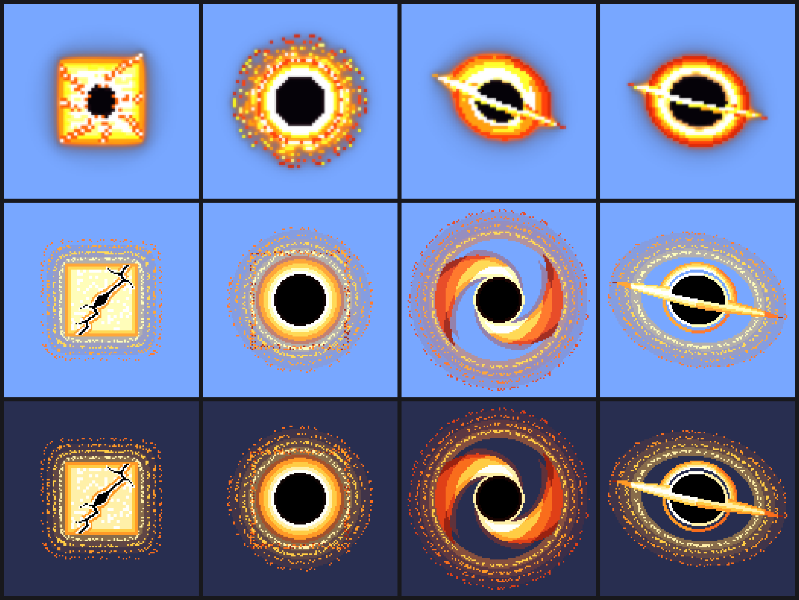
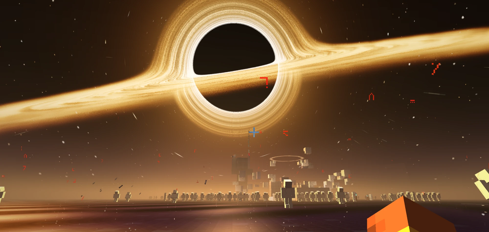
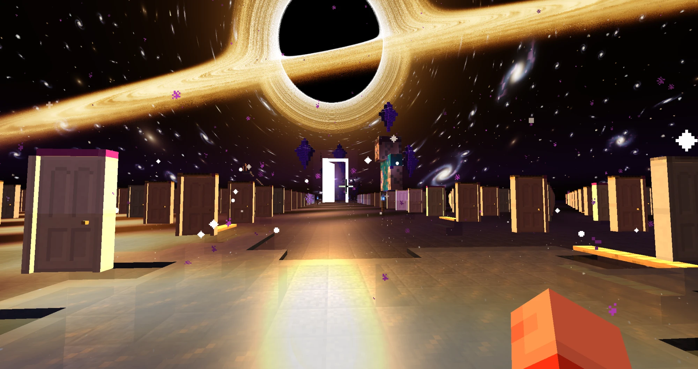
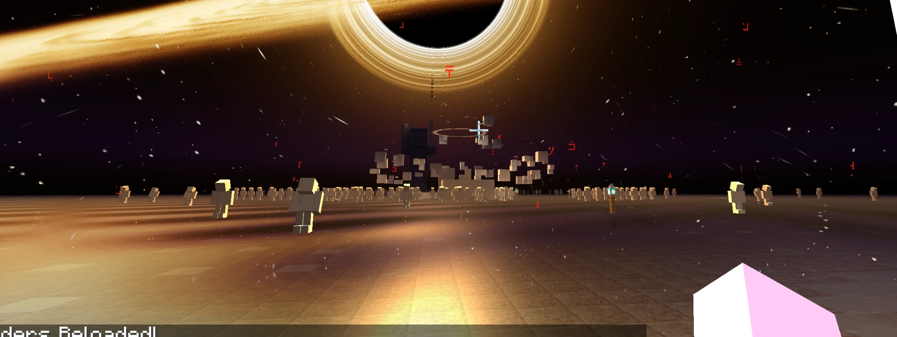
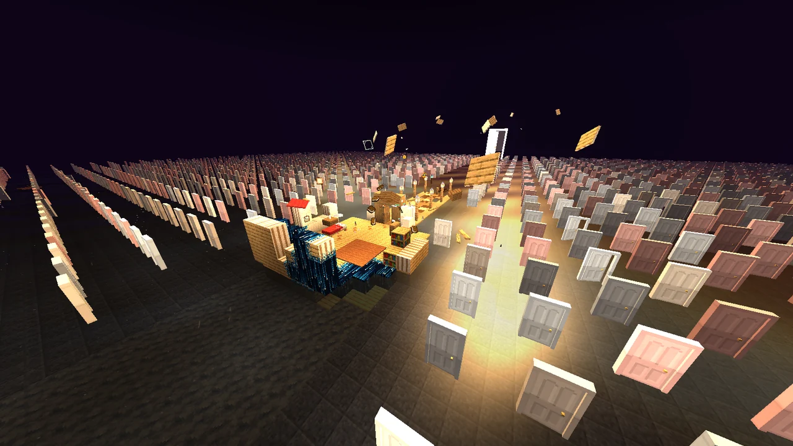
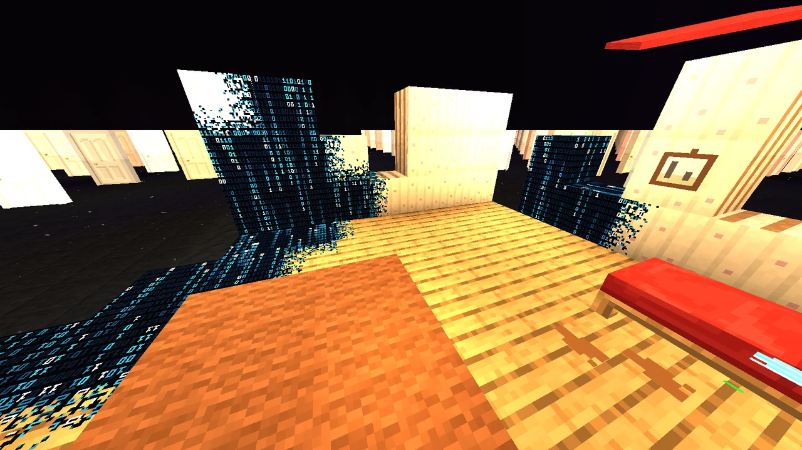
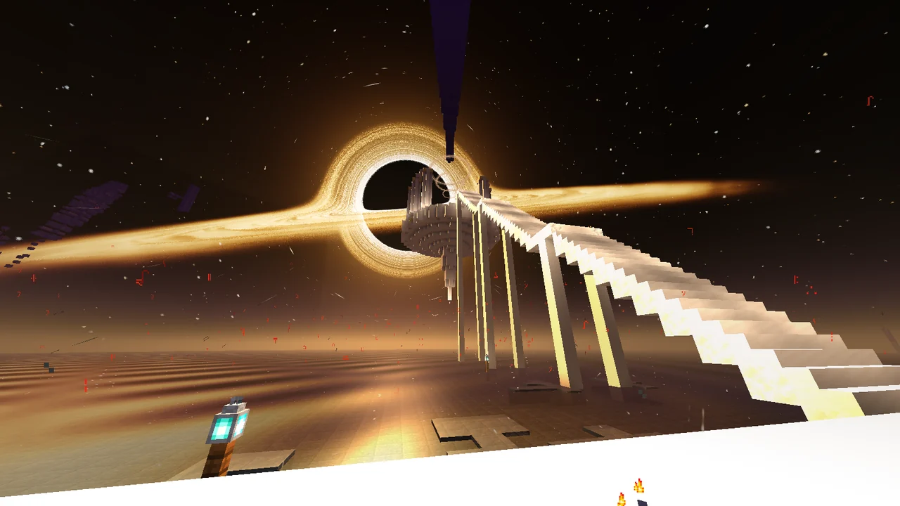
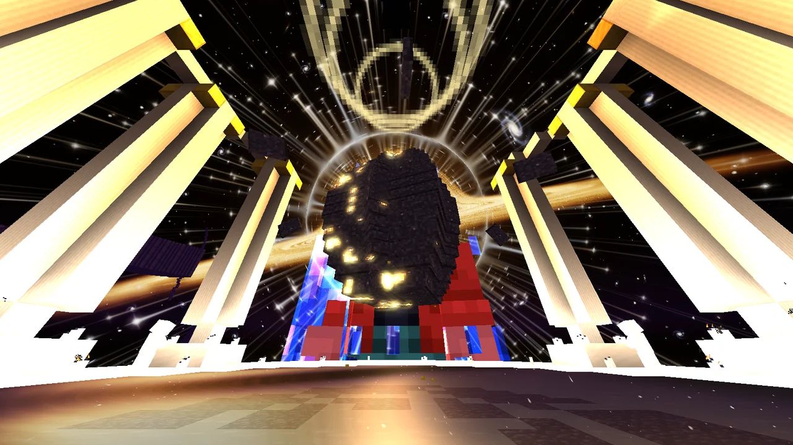
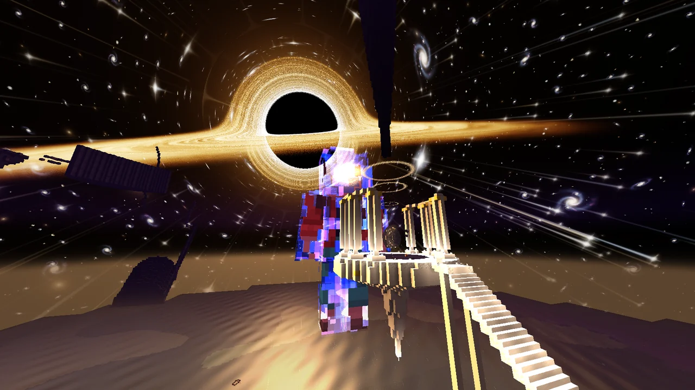

<div align="center">

# PROJECT: SAMSARA

**`Minecraft 1.20.1-SAMSARA-REL`**

*Nếu một ngày em mở file này ra, đừng bấm ngủ.*


</div>

---

Một ARG kinh dị trên Minecraft, kể theo lối **found footage**. Kênh của *Investigator Channy* mổ xẻ những tệp ghi hình OBS mà `Nam_1998` để lại trước khi biến mất. Còn người chơi thì tự bước vào thế giới ấy qua bản mod Fabric này.

Mỗi lần bạn ngủ, thế giới nứt thêm một chút.

<div align="center">

<br><sub>Mặt Trời qua ống kính máy quay, từ Stage 1 tới Stage 4. Mắt thường chỉ thấy Mặt Trời bình thường.</sub>
</div>

## Trải nghiệm

- **Giấc ngủ là một cái chết nhỏ.** Ngủ thì thoát bầy Phantom, nhưng mỗi giấc ngủ đẩy thế giới lên một stage mới.
- **Máy quay VHS** tự xuất hiện trong ô số 3. Có những thứ chỉ hiện ra qua ống kính.
- **Kinh dị tầng giao diện**: chat, bảng F3, menu, tên cửa sổ, tên thế giới… không phải lúc nào cũng nói thật.
- **Shaderpack VHS riêng** (Iris): nhiễu băng, quầng sáng, thế giới bị bẻ cong.
- Toàn bộ chữ trong game là **tiếng Việt**.

## Hình ảnh

<div align="center">

<br><sub>The Womb: những khổng thần thạch cao và đoàn tượng quỳ, tất cả hướng về con mắt Gargantua.</sub>
<br><br>
<table>
<tr>
<td align="center"><br><sub>Những Cánh Cửa: mỗi cánh cửa là một kiếp<br>(ảnh dựng thử, trước khi có tường căn phòng)</sub></td>
<td align="center"><br><sub>Hố Nổ 2013: vụ nổ dừng lại giữa chừng</sub></td>
</tr>
<tr>
<td align="center"><br><sub>Bến Đò: căn phòng ngủ đang tan ra giữa biển cửa</sub></td>
<td align="center"><br><sub>Nơi bạn thức dậy: bên dưới lớp gỗ chỉ là dữ liệu</sub></td>
</tr>
<tr>
<td align="center"><br><sub>Tháp Ngược: đại cầu thang đi thẳng vào con mắt</sub></td>
<td align="center"><br><sub>Quả Trứng ở tâm của vạn vật</sub></td>
</tr>
<tr>
<td align="center" colspan="2"><br><sub>Đoạn kết: cái bóng ×45, thánh đường và con mắt Gargantua</sub></td>
</tr>
</table>
</div>

<details>
<summary><b>⚠️ Tiết lộ nội dung: mạch chơi đầy đủ</b></summary>

<br>

| Stage | Lần ngủ | Dị tượng |
| :---: | :---: | :--- |
| 1 | 1–2 | Cừu đứng im nhìn về Bia Mộ, nhạc nền bị giật |
| 2 | 3–4 | Nước xám bạc, cây chỉ lớn khi nhìn qua máy quay, những bóng người đứng quanh nhà |
| 3 | 5–6 | Cát và sỏi bay ngược lên trời, la bàn quay loạn |
| 4 | 7+ | Mặt đất bị hút lên trời |

Sau giấc ngủ thứ 7 là **Ký Ức Của Nam**: cánh đồng hướng dương và căn nhà tháng 5/2018. Dưới hầm nhà có một vết rách dẫn tới **The Womb**, một tuyến hành hương bằng thuyền gồm bốn chương:

1. **Bến Đò** và 2. **Những Cánh Cửa**: bạn tỉnh dậy trong phòng ngủ của Nam đang tan ra thành dữ liệu, giữa một căn phòng tối mênh mông đầy những cánh cửa giống hệt nhau. Lối ra duy nhất là một cánh cửa trắng hé mở.
3. **Những Người Khổng Lồ**: bước qua cánh cửa là vũ trụ dưới con mắt Gargantua. Những khổng thần thạch cao là các lần bạn đã chết, trước mỗi khổng thần là một đoàn tượng quỳ.
4. **Tháp Ngược**: đại cầu thang trắng, cánh cửa cuối cùng do chính bạn mở, và một Quả Trứng giữa thánh đường treo dưới con mắt Gargantua.

Qua ống kính máy quay, mỗi cánh cửa có tên một thế giới cũ, mỗi bức tượng có một dòng thông báo chết.

</details>

## Cấu trúc dự án

```
mod/                    Mod Fabric (mã nguồn, tài nguyên, script sinh texture)
  src/main/java/com/samsara/
  src/main/resources/assets/samsara/lang/vi_vn.json
  tools/                Script Python sinh texture và model (mặt trời, trứng, máy quay, cửa, tượng...)
docs/images/            Ảnh chụp trong game dùng cho README
shader/
  Samsara-Cosmic-Shaders/   Shaderpack Iris (kiểu máy quay VHS)
scripts/                Tài liệu kịch bản và hiện trạng trong mod
HANDOFF.md              Trạng thái triển khai, bản đồ code, lệnh test
start_samsara.bat       Build và mở dev client bằng một cú nhấp
```

## Build

Cần **JDK 21** để chạy Gradle (mod vẫn biên dịch cho Java 17) và **Gradle 8.6**.

```bash
cd mod
gradle build
```

File jar nằm ở `mod/build/libs/project-samsara-1.0.0.jar`. Trên Windows có thể nhấp đúp `start_samsara.bat` để build và mở dev client luôn.

### Chạy kèm shader

1. Cài [Iris](https://modrinth.com/mod/iris) và [Sodium](https://modrinth.com/mod/sodium) cho 1.20.1.
2. Chép thư mục `shader/Samsara-Cosmic-Shaders` vào `.minecraft/shaderpacks/`.
3. Chọn shader trong *Tuỳ chọn → Video → Shader Packs*.

## Lệnh thử nghiệm

Mọi tính năng đều có lệnh debug dạng `/samsara test <tính_năng>`. Gõ `/samsara test help` để xem danh sách.

```
/samsara test sleep_count 5     nhảy tới Stage 3
/samsara test camcorder_gift    nhận máy quay
/samsara nam                    tới Ký Ức Của Nam
/samsara womb                   tới The Womb
```

---

<div align="center">
<sub><i>Đằng sau nút "Lưu &amp; Thoát khỏi thế giới"... luôn luôn là nút "Tạo thế giới mới".</i></sub>
</div>
